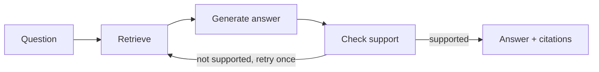

# Document Q&A Agent (LangGraph + LangChain)

A small question-answering assistant for PDF documents. Upload a PDF, ask a question, and get an answer with page citations. A LangGraph workflow retrieves relevant passages, generates an answer from them, and then checks whether the answer is supported by the retrieved text.

## How it works



1. **Index (once per document):** PDF pages are loaded, whitespace is cleaned, empty pages are dropped, and the text is split into overlapping chunks. Each chunk is embedded with the Gemini embedding model and stored in a FAISS vector store. Embedding requests are sent in small batches with pauses to stay inside free-tier rate limits.
2. **Retrieve:** the top-k most similar chunks are fetched for the question.
3. **Generate:** the LLM answers using only the retrieved text and cites page numbers. If the answer is not in the text, it is told to say it doesn't know.
4. **Check:** the LLM judges whether the answer is fully supported by the retrieved text. If not, the graph retries once with more retrieved chunks. The UI shows whether the answer was verified.

## Tech stack

Python, LangGraph, LangChain, Google Gemini API (LLM and embeddings), FAISS, PyPDF, Streamlit.

## Setup

```bash
git clone https://github.com/Sricharan927/doc-qa-agent.git
cd doc-qa-agent
python -m venv venv
venv\Scripts\activate        # Windows PowerShell. On Mac/Linux: source venv/bin/activate
pip install -r requirements.txt
```

Create a file named `.env` in the project folder (never commit it):

```
GOOGLE_API_KEY=your_key_from_aistudio.google.com
LLM_MODEL=gemini-3.5-flash-lite
EMBEDDING_MODEL=gemini-embedding-001
```

Model names change often. Check the Gemini API model list and pick one with a free tier.

## Run

```bash
streamlit run app.py
```

Upload a PDF in the sidebar, click **Build index**, then ask questions. The "Retrieved passages" section shows exactly what text the answer was based on.

## Evaluation

`evaluate.py` runs a set of questions from `tests.json` and counts an answer as correct if it contains all the required keywords. The test document is not included in this repository; add your own PDF and questions.

| Chunk size | Top-k | Model | Score |
|---|---|---|---|
| 800 | 4 | gemini-3.5-flash-lite | 12/12 (100%) |
| 400 | 4 | gemini-3.5-flash-lite | 11/12 (92%) |

Test set: 12 factual questions written from a literature review document (authors, numbers, methods, named results).

### Limitations

- **Small, easy test set.** All 12 questions ask for a single fact from one passage. A one-question difference between chunk sizes is within run-to-run noise, so this does not show that 800 is better than 400.
- **Keyword scoring is strict.** A correct answer worded differently (for example "seven" instead of "7") can be marked wrong, and it cannot tell whether extra text in the answer is correct.
- **The checker is an LLM, so it can be wrong in both directions.** In manual testing it flagged one correct answer as "not fully verified". It reduces obvious unsupported answers but is not a guarantee.
- **Multi-document and multi-step questions are not evaluated yet.**
- **Free-tier API limits** (requests per minute and per day) can interrupt indexing or evaluation. The code batches embeddings and retries on rate-limit errors in `evaluate.py`.

## Project structure

```
app.py            Streamlit interface
rag_graph.py      indexing + LangGraph workflow (retrieve, generate, check)
evaluate.py       keyword-based accuracy test with rate-limit handling
tests.json        test questions and required keywords
quick_test.py     minimal end-to-end check of indexing and the graph
requirements.txt  dependencies
```
